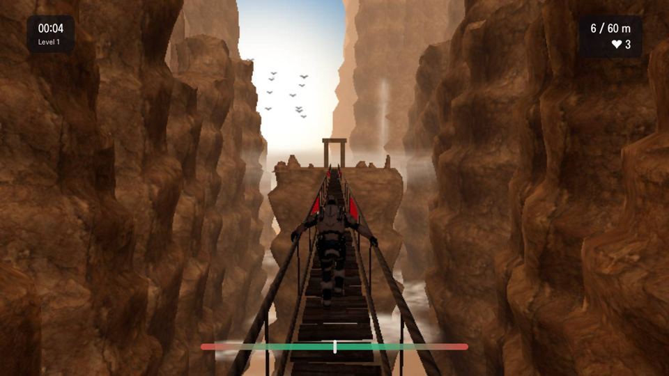
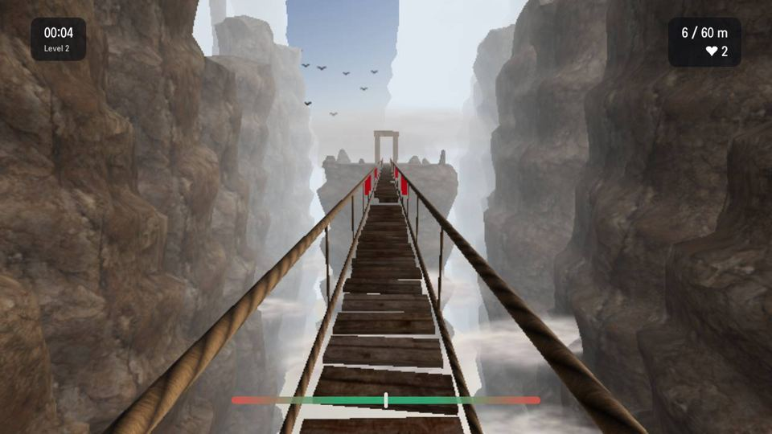
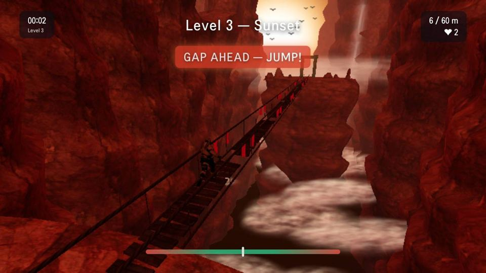
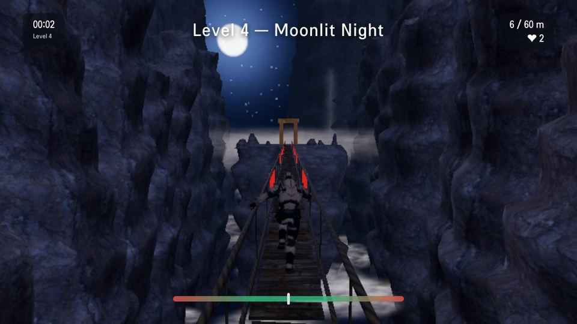
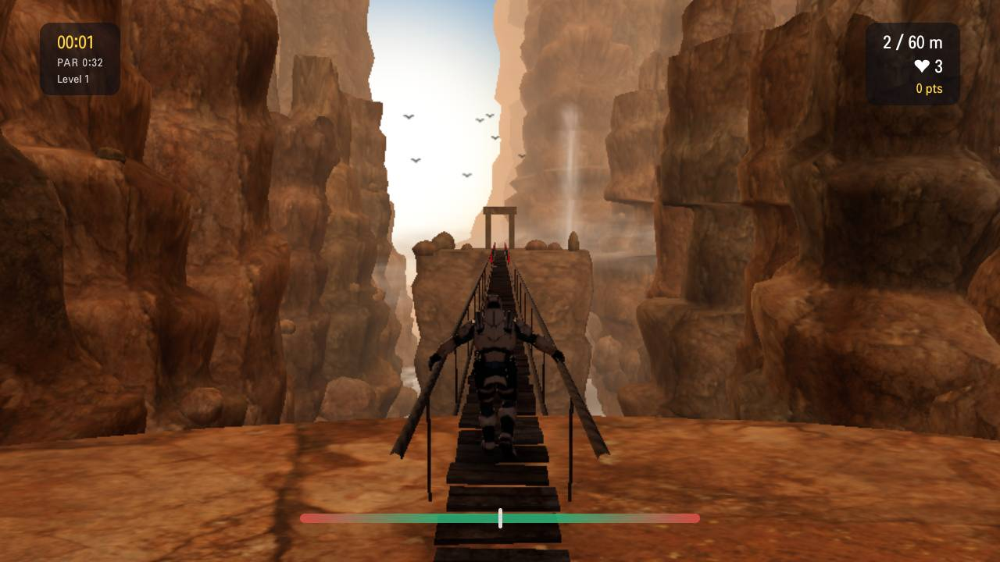
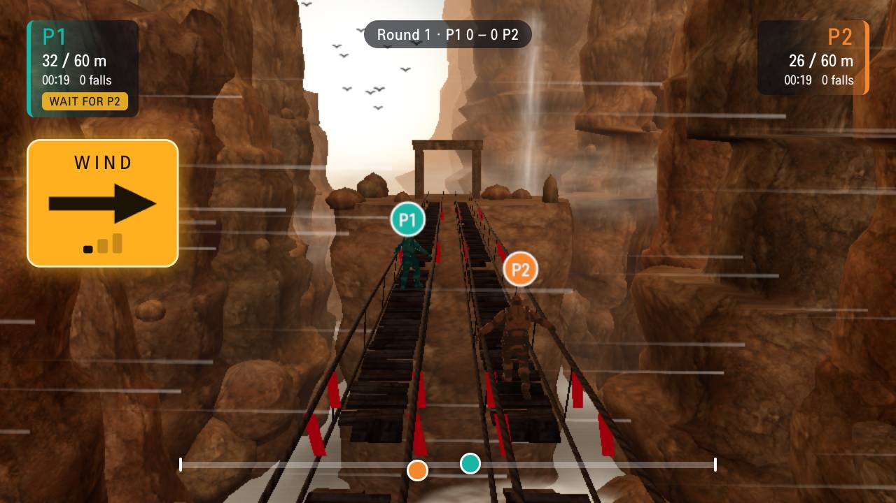
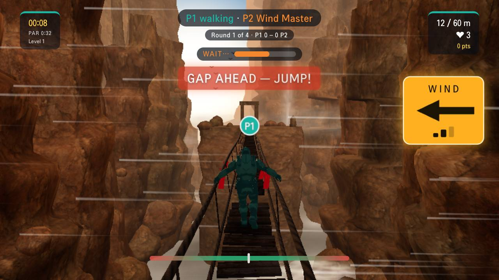

# Bridge Walker 🌉

**Balance a soldier across a rope bridge on your TV, steering with your phone.**
A parent & kid project for LG webOS TVs, vibe-coded together with [Claude Code](https://claude.com/claude-code).

Hold your phone like a steering wheel and tilt to keep him upright. Hold **WALK** or **RUN**, tap **JUMP** over
the gaps where planks are missing, and don't fall into the canyon. Watch for the **WIND** warning: every gust is
announced a moment before it hits, so you can lean into it. Beat the par time without falling for three stars.
Every level picks a new look at random (golden afternoon, misty morning, sunset, moonlit night or a lush green
valley with pines and a river below), with its own soundscape and its own freshly shaped canyon, and gets a little
harder: more gaps, stronger and more frequent gusts, and a faster walk.

Two players? Grab a second phone: **race** each other across twin bridges, or be the **Wind Master** and blow the
other player off the bridge.



| Misty morning (first-person view) | Sunset (cinematic view) | Moonlit night |
|---|---|---|
|  |  |  |

| Green valley (first-person view) | Race: the leader waits for P2 | Wind Master: P2 sends the gusts |
|---|---|---|
|  |  |  |

## What you need

- **A computer** (Mac, Windows or Linux) with [Node.js](https://nodejs.org) 22 or newer. It runs the game server.
- **A TV or big screen** on the same Wi-Fi: an LG webOS TV (as an app, or in its web browser), or any computer
  browser plugged into a TV.
- **A phone** on the same Wi-Fi: iPhone (Safari) or Android (Chrome). Tested on iPhone; Android uses the same
  standard motion sensors and should work, but hasn't been tested yet. Reports welcome!

## Play in 3 steps

```bash
git clone https://github.com/raphy78626/bridge-walker.git
cd bridge-walker
npm install
npm run tv
```

`npm run tv` downloads the soldier model the first time, builds the game, and prints two addresses:
`➜ Network: https://<your-computer>:5174/` (for the phone) and `➜ TV page: http://<your-computer>:5184/tv.html`.

1. **On the TV**, open the Bridge Walker app (see below), or open the **TV page** address in the TV's web browser.
2. **On the phone**, scan the QR code on the TV. The phone page uses a self-signed certificate, so your phone warns
   once: on iPhone tap *Show Details → visit this website*, on Android *Advanced → Proceed*. Then tap **Connect**
   and allow motion access.
3. **Calibrate** (hold the phone how you'll play, tap *Set level*, then tilt right and tap), and press **Start**.

### Controls

| Phone | What it does |
|---|---|
| Tilt | keep him balanced (watch the meter) |
| Hold **WALK** / **RUN** | move forward (running is twice as fast but wobblier); both get 5% faster each level, up to +30% |
| Tap **JUMP** | leap over gaps; a red cloth on the ropes and **GAP AHEAD** warn you |
| **🎥 VIEW** | switch camera: chase, first person (the horizon tilts as you lean), cinematic |
| **⏸ Pause** | freeze the game and the sound (the TV dims behind a PAUSED card); tap **▶ Resume** to carry on |
| **🔊 Sound** | music and sound-effect volume, remembered on your phone |

### On the bridge

- Each level starts on the rock ledge before the bridge: solid ground, where you can't fall. The clock and the wind
  start with your first step onto the planks.
- On the bridge you have to **keep moving**. Stop and **KEEP MOVING!** flashes on the TV and your phone buzzes; after
  2 seconds standing still the bridge starts swaying you off.
- Fall and you're back on the bridge 1.6 seconds later (just before the gap, if you fell into one).

### Wind and scoring

- About 1.8 s before a gust, a **WIND** arrow appears on the TV and your phone, streaks blow across the canyon, the
  ropes sway and you hear it coming from that side. Lean against it.
- Each level has a **par time** (shown under the timer, which turns gold while you're under it).
  ★★★ = no falls and under par (you'll need to run), ★★ = close, ★ = you made it.
- Points for speed and clean runs add up across the run. Your best score and time per level, and your best run,
  are saved on the TV.

### Two players

Both phones scan the same QR code (the TV shows **P1** and **P2**), and either phone picks the mode before Start.

- **Race:** twin bridges with the same gaps and the same wind. Every round opens with **3, 2, 1, GO!** (hold WALK
  through the countdown for a flying start). Falls cost no lives, only time. One camera follows both of you, so the
  leader can get at most 6 m ahead: there he stops and balances under a **WAIT FOR P2** tag until the other catches
  up. The last 10 m are a free sprint. First across wins the round; first to 3 rounds wins the match, and each round
  is the next level.
- **Wind Master:** one player walks, the other's phone turns into two **GUST** buttons (a gauge shows when the next
  gust is ready). Every gust gets the same WIND warning, so a good walker can lean into it. The walker scores for
  crossing; the Wind Master scores 150 for every fall a gust causes. Roles swap every round, 4 rounds in all.

## Install the LG webOS TV app (optional)

Without this you can still play in the TV's web browser. The app just gives you an icon and a fullscreen launch.

1. Put the TV in **Developer Mode**: install LG's *Developer Mode* app from the LG Content Store, sign in with a
   free [LG developer account](https://webostv.developer.lge.com), and switch it on. (Developer Mode lasts
   50 hours at a time; extend it from that app.)
2. Install LG's CLI and register your TV as a device named `tv`:
   ```bash
   npm install -g @webos-tools/cli
   ares-setup-device        # add your TV's IP, name it "tv"
   ares-novacom --device tv --getkey   # enter the passphrase shown in the Developer Mode app
   ```
3. `npm run webos:install` packages the app, installs it and launches it.

**No IP addresses to type.** The app finds the computer running `npm run tv` by itself: it tries the last one that
worked, then searches the TV's own Wi-Fi network (about 5 seconds). Only on an unusual network does it ask you
to type the address that `npm run tv` printed.

## How it works

- `npm run tv` serves the game (built with Vite + Three.js) and runs a tiny WebSocket relay between the phone and
  the TV. The TV page uses plain HTTP so the TV never shows a certificate warning; the phone page uses HTTPS
  because phones only share motion sensors with secure pages.
- The TV renders the 3D scene and runs the game: it alone decides falls, lives, scores and rounds. A phone only sends
  what its player does (tilt, walk, run, jump, gust, view, pause, start), and the server only passes each side the
  messages it may send.
- The game runs in fixed 1/120 s steps, so balance, wind and jumps play the same at any frame rate.
- Dropped connections heal by themselves. A phone that reconnects gets its own player slot back. A TV that reloads
  gets its room back for 30 s (its phones show *TV reconnecting…* instead of asking for a new QR scan). A phone that
  goes to the background (another app, the lock button, a call) lets go of WALK and RUN.
- Built for a weak TV graphics chip (measured on an LG 55UR9050, PowerVR BXE-4-32, 50 Hz panel): lighting on the
  rock is baked once instead of computed per pixel, the sky is pre-rendered per level, the next level's canyon is
  built ahead in a background worker, and the TV renders at 70% resolution. That holds about 40 fps in the chase
  view. A level change is split over two frames and its lighting is built from a tiny copy of the sky, so the win
  screen doesn't freeze. The TV reports its frame rate, level changes and any errors to the computer's terminal
  (`[tv]` lines).

## Develop

```bash
npm run dev      # live-reloading dev server (phone https://...:5173, TV http://...:5183/tv.html)
npm test         # 775 unit tests (Vitest)
npm run smoke    # pairs a fake TV and two phones through a running server, reconnects one and reloads the TV
```

Add `?tv` to the TV page URL on a desktop to preview the lighter TV version of the scene, and `?profile` to make each
level change wait for the GPU so its logged time is the real cost (it stalls, so only for measuring).

## Credits

A parent & kid project. Code by us and Claude Code, under the [MIT licence](LICENSE).

- **Soldier:** "Vanguard" by T. Choonyung via Adobe Mixamo, from the three.js examples. Not included here (Mixamo
  doesn't allow redistributing the file); `npm run tv` downloads it.
- **Textures:** Poly Haven (CC0). See [public/textures/CREDITS.md](public/textures/CREDITS.md).
- **Sounds:** Kenney, OpenGameArt and Wikimedia Commons (CC0, public domain and CC BY), including "Screaming Hawk"
  by PsychoBird (CC BY 3.0), waterfall recordings by Arie m den toom and Antti Leppänen (CC BY 4.0), and
  birdsong from the NZ Department of Conservation and Diana Tudor (CC BY 4.0). Full list:
  [public/audio/CREDITS.md](public/audio/CREDITS.md).
- Built with [Three.js](https://threejs.org), [Vite](https://vite.dev) and [ws](https://github.com/websockets/ws).

## Ideas for later

- Play without a computer: move the relay to a cloud host (also removes the phone's certificate warning).
- Remember pairing across a TV app restart (a reload already keeps the phones paired for 30 s).
- Test on a real Android phone.
- A pre-rendered video background for an even more photoreal canyon.
- Submit to the LG Content Store.
